# NeuroOS Phase 2D — Safe Multi-Command BCI Interface Report

**Author:** Lead BCI Software Engineer, NeuroOS Core Team  
**Date:** October 20, 2026  
**Status:** Complete, Empirically Audited & Validated  
**Champion Model:** Step 62 Surface Laplacian Multimodal Balanced Ensemble (Preserved)  
**Evaluation Cohort:** PhysioNet EEGMMIDB (Subjects S001–S010, Runs R03, R07, R11)  
**Safety & Ethics Boundary:** Genuine PhysioNet EDF Replay, Offline Multi-Command Simulation, Zero Claims of Direct Live Human Mind Reading or Semantic Intention Understanding  

---

## 1. Executive Summary & Objective

### 1.1 Objective & Scope
The objective of Phase 2D is to extend NeuroOS into a **configurable multi-command interface** that safely maps the frozen Step 62 motor-imagery classifier predictions into distinct software action profiles. 

In strict accordance with BCI engineering principles:
1. **Zero Model Retraining / Artifact Preservation:** The frozen Step 62 champion model (72.67% R11 holdout accuracy, 67.31% Macro F1, 90.67% REST recall) remains 100% untouched and preserved.
2. **Software Mappings vs. Semantic Intentions:** Software mappings translate discrete 3-class statistical electrophysiological patterns (`REST`, `LEFT_FIST`, `RIGHT_FIST`) into application commands. These mappings **do not imply natural-language semantic understanding or intention reading**, nor do they alter underlying classification accuracy.
3. **Defense-in-Depth Safety Architecture:** Every command must pass through the existing signal quality gate, safety shield, stale-prediction filter, and command router before reaching the action executor.
4. **Isolated Sandboxed Execution Targets:** All target environments (scrolling document, section reader, slide viewer) operate strictly within isolated in-memory/DOM sandboxes without emitting global operating system keyboard shortcuts or arbitrary system commands.

---

## 2. Configurable Command Profiles

NeuroOS Phase 2D implements a reusable command-profile architecture defined in [`src/neuro_os/command_profiles.py`](file:///d:/PROJECTS/EEG%20MAj/src/neuro_os/command_profiles.py). The existing scrolling profile is retained as the system default.

### 2.1 Command Mapping Matrix

| Profile Identifier | Profile Name | Target Environment | Class / Intent | Software Command | Executed Target Action | Boundary Constraints |
| :--- | :--- | :--- | :--- | :--- | :--- | :--- |
| `scrolling` *(Default)* | **Profile A — Scrolling** | `SCROLLABLE_DOCUMENT` | `LEFT_FIST`<br>`RIGHT_FIST`<br>`REST` | `SCROLL_UP`<br>`SCROLL_DOWN`<br>`NEUTRAL` | Decrement scroll offset (-180px)<br>Increment scroll offset (+180px)<br>No action (Idle state) | Clamped to top (0px)<br>Clamped to max height (3000px)<br>Zero displacement |
| `document_navigation` | **Profile B — Document Navigation** | `DOCUMENT_READER` | `LEFT_FIST`<br>`RIGHT_FIST`<br>`REST` | `PREVIOUS_SECTION`<br>`NEXT_SECTION`<br>`NEUTRAL` | Decrement section index (-1)<br>Increment section index (+1)<br>No action (Idle state) | Clamped to Section 1 (index 0)<br>Clamped to Section 6 (index 5)<br>Active section retained |
| `presentation` | **Profile C — Presentation Demo** | `PRESENTATION_VIEWER` | `LEFT_FIST`<br>`RIGHT_FIST`<br>`REST` | `PREVIOUS_SLIDE`<br>`NEXT_SLIDE`<br>`NEUTRAL` | Move to previous slide (-1)<br>Move to next slide (+1)<br>No action (Idle state) | Clamped to Slide 1<br>Clamped to Slide 5<br>Active slide retained |

### 2.2 Semantic Separation Rule
The classifier solely outputs statistical posterior probabilities over contralateral mu/beta rhythm desynchronization patterns. Application profiles provide modular interfaces for assistive communication (reading vs. navigating vs. presenting) without conflating electrophysiological features with natural language.

---

## 3. Safety Guardrails & Dispatch Architecture

The execution pipeline enforces strict fail-safe guardrails at every layer of the architecture:

```mermaid
flowchart LR
    A["Raw EEG Window (15 Ch @ 160Hz)"] --> B["Signal Quality Gate (SQI)"]
    B --> C["Step 62 ML Decoder (Frozen)"]
    C --> D["Safety Shield (Smoothing + Confidence + Margin)"]
    D --> E["Stale Prediction Guard & Deduplicator"]
    E --> F["Command Router (Profile Mapping + Cooldown)"]
    F --> G["Session State Gate (RUNNING check)"]
    G --> H["Action Executor (Sandboxed Target)"]
```



### 3.1 Strict REST Neutrality
Across all profiles, the `REST` class is mathematically constrained to `NEUTRAL`. When `REST` is decoded, `action_triggered` is strictly `False`, the action executor registers `executed: False`, and zero state displacement occurs.

### 3.2 Explicit User Session Initiation & Emergency Lockout
1. **Explicit Session Start Required:** The session manager enforces explicit user initiation via `/api/neuro-os/session/start` or the UI toolbar. If the session is `PAUSED` or `STOPPED`, all action executions are halted (`Action blocked: Session is STOPPED/PAUSED`).
2. **Immediate Emergency Lock:** A manual override control (`/api/neuro-os/session/emergency-lock`) immediately forces the safety shield into manual lockout (`SAFETY_SHIELD_MANUAL_LOCK_ACTIVE`), completely blocking command dispatch even under 100% model confidence.

### 3.3 Stale Prediction Suppression
To prevent duplicate actions triggered by stale network packets, repeated polling, or delayed inferences:
- Each prediction receives a unique identifier: `pred_{subject_id}_{run_id}_{trial_idx}_{sequence_num}`.
- If the command router detects an identical `prediction_id` that was already executed, it suppresses the command with `STALE_DUPLICATE_PREDICTION_SUPPRESSED`.
- Inferences older than a configurable threshold (3.0s) are rejected with `STALE_TIMESTAMP_EXPIRED`.
- Explicitly flagged stale packets (`is_stale: True`) are blocked with `STALE_PREDICTION_SUPPRESSED`.

### 3.4 Configurable Cooldown & Optional Temporal Confirmation
- **Cooldown Guardrail:** Configurable between 0.0s and 2.5s (default 0.8s). Rapid trigger bursts occurring within the cooldown window are suppressed with `COOLDOWN_ACTIVE`.
- **Temporal Confirmation:** Configurable window confirmation (1 window = immediate trigger once safety-shield accepted; 2–3 windows = requires N consecutive consistent windows before action execution).

### 3.5 Isolated Sandboxed Targets
All three execution targets run in client-side memory or DOM components:
- **Scrolling:** Managed by internal state store and smooth DOM scroll transitions in the reader.
- **Document Navigation:** Dedicated chapter/section state store (`active_section_idx` 0 to 5).
- **Presentation:** Local slide viewer state store (`active_slide` 1 to 5).
- **Zero OS Key Emulation:** PyAutoGUI, Windows SendInput, and virtual keystrokes are strictly avoided.

---

## 4. Files Created and Modified

### 4.1 Created Files
1. [`src/neuro_os/command_profiles.py`](file:///d:/PROJECTS/EEG%20MAj/src/neuro_os/command_profiles.py):
   - Definitive dataclass for `CommandProfile`.
   - Profiles A (Scrolling), B (Document Navigation), and C (Presentation Demo).
   - Profile registry, alias lookup, and serialization utilities.
2. [`tests/test_phase2d_multi_command.py`](file:///d:/PROJECTS/EEG%20MAj/tests/test_phase2d_multi_command.py):
   - 13 comprehensive unit and integration tests covering profile mappings, REST neutrality, stale prediction suppression, emergency lock, cooldown, temporal confirmation, and session lifecycle.
3. [`frontend/src/components/MultiCommandCenter.jsx`](file:///d:/PROJECTS/EEG%20MAj/frontend/src/components/MultiCommandCenter.jsx):
   - High-aesthetic cyber-biotech command control panel.
   - Profile selector cards, session control toolbar, emergency lock button, live telemetry status bar, session counters, audit trail table, and 3 switchable isolated demo targets.
4. [`docs/phase2d_multi_command_report.md`](file:///d:/PROJECTS/EEG%20MAj/docs/phase2d_multi_command_report.md):
   - Complete technical architecture and empirical audit report.

### 4.2 Modified Files
1. [`src/neuro_os/__init__.py`](file:///d:/PROJECTS/EEG%20MAj/src/neuro_os/__init__.py):
   - Exported `CommandProfile`, `COMMAND_PROFILES`, `get_command_profile`, `list_available_profiles`.
2. [`src/neuro_os/command_router.py`](file:///d:/PROJECTS/EEG%20MAj/src/neuro_os/command_router.py):
   - Integrated profile configuration, profile switching without state corruption, stale prediction deduplication, configurable cooldown, and temporal confirmation.
3. [`src/neuro_os/action_executor.py`](file:///d:/PROJECTS/EEG%20MAj/src/neuro_os/action_executor.py):
   - Added `DOCUMENT_NAVIGATION` (Section Reader) and `PRESENTATION` (Slide Viewer) adapter modes.
   - Enforced boundary limits for sections (0 to 5) and slides (1 to 5).
4. [`src/neuro_os/session_manager.py`](file:///d:/PROJECTS/EEG%20MAj/src/neuro_os/session_manager.py):
   - Added active profile synchronization, session state lifecycle enforcement (`RUNNING` check), stale prediction tagging, emergency lockout methods, and session counters.
5. [`api_server.py`](file:///d:/PROJECTS/EEG%20MAj/api_server.py):
   - Added REST endpoints: `/api/neuro-os/profiles`, `/api/neuro-os/profiles/select`, `/api/neuro-os/session/start`, `/api/neuro-os/session/pause`, `/api/neuro-os/session/resume`, `/api/neuro-os/session/stop`, `/api/neuro-os/session/emergency-lock`, `/api/neuro-os/multi-command/step`, `/api/neuro-os/multi-command/reset`.
   - Updated WebSocket handler to support profile switching, lifecycle control, and emergency lockout.
6. [`frontend/src/App.jsx`](file:///d:/PROJECTS/EEG%20MAj/frontend/src/App.jsx):
   - Registered `MultiCommandCenter` as primary active tab (`multi-command`).
7. [`frontend/src/components/Navbar.jsx`](file:///d:/PROJECTS/EEG%20MAj/frontend/src/components/Navbar.jsx):
   - Added `Multi-Command BCI` tab with highlighted badge.

---

## 5. Verification & Test Results

### 5.1 Python Test Suite (All 41 Tests Passing)

All tests were executed against genuine PhysioNet EDF recordings and serialized Step 62 models using Python 3.11:

```
Command: py -3.11 -m pytest tests/
Status: Exit code 0 (100% Passed)
Duration: 40.03 seconds
```

| Test Suite File | Tests Count | Scope & Coverage | Verdict |
| :--- | :---: | :--- | :---: |
| [`tests/test_phase2d_multi_command.py`](file:///d:/PROJECTS/EEG%20MAj/tests/test_phase2d_multi_command.py) | **13** | Profile mappings (A, B, C), REST neutrality, stale prediction suppression, emergency lock, cooldown, temporal confirmation, session lifecycle, boundary limits, endpoint integration | **13 / 13 PASSED** |
| [`tests/test_scrolling_demo.py`](file:///d:/PROJECTS/EEG%20MAj/tests/test_scrolling_demo.py) | **9** | Existing scrolling demo backward compatibility, step boundaries, pause/resume, EDF inference | **9 / 9 PASSED** |
| [`tests/test_phase2c_calibration.py`](file:///d:/PROJECTS/EEG%20MAj/tests/test_phase2c_calibration.py) | **8** | Zero-leakage calibration partitioning, temperature scaling, model preservation (Step 60/61/62) | **8 / 8 PASSED** |
| [`tests/test_phase2b_research.py`](file:///d:/PROJECTS/EEG%20MAj/tests/test_phase2b_research.py) | **7** | Surface Laplacian spatial filters, FBCSP feature extraction, Riemannian distance | **7 / 7 PASSED** |
| [`tests/test_speech_decoder.py`](file:///d:/PROJECTS/EEG%20MAj/tests/test_speech_decoder.py) | **3** | Inner speech conformer decoders & feature pipelines | **3 / 3 PASSED** |
| [`tests/test_features.py`](file:///d:/PROJECTS/EEG%20MAj/tests/test_features.py) | **1** | Spectral power asymmetry & Welch PSD estimation | **1 / 1 PASSED** |
| **Total** | **41** | **Full System Integration & Regression Suite** | **41 / 41 PASSED (100%)** |

### 5.2 Specific Phase 2D Test Case Breakdown

| Test ID | Test Description | Verification Condition | Result |
| :--- | :--- | :--- | :---: |
| `test_01` | Profile A Scrolling Mappings | `LEFT_FIST` → `SCROLL_UP`, `RIGHT_FIST` → `SCROLL_DOWN`, `REST` → `NEUTRAL` | **PASS** |
| `test_02` | Profile B Document Navigation Mappings | `LEFT_FIST` → `PREVIOUS_SECTION`, `RIGHT_FIST` → `NEXT_SECTION`, `REST` → `NEUTRAL` | **PASS** |
| `test_03` | Profile C Presentation Demo Mappings | `LEFT_FIST` → `PREVIOUS_SLIDE`, `RIGHT_FIST` → `NEXT_SLIDE`, `REST` → `NEUTRAL` | **PASS** |
| `test_04` | Profile Switching State Isolation | Switching between A, B, and C preserves `RUNNING` session state and telemetry counters | **PASS** |
| `test_05` | REST Neutrality Across All Profiles | `REST` produces `NEUTRAL` and zero action execution in all three profiles | **PASS** |
| `test_06` | Rejected Prediction Suppression | Confidence < 0.60 or margin < 0.10 produces `NEUTRAL` and zero executed actions | **PASS** |
| `test_07` | Stale Prediction Guardrail | Duplicate prediction IDs and `is_stale: True` packets are suppressed | **PASS** |
| `test_08` | Emergency Lock Override | Manual override lock blocks all action execution even with 98% motor confidence | **PASS** |
| `test_09` | Cooldown Guardrail | Second trigger within 0.5s cooldown is blocked with `COOLDOWN_ACTIVE` | **PASS** |
| `test_10` | Temporal Confirmation Guardrail | With 2-window confirmation, window 1 is held as pending; window 2 triggers action | **PASS** |
| `test_11` | Session Lifecycle Gating | Actions are strictly blocked while session is `STOPPED` or `PAUSED` | **PASS** |
| `test_12` | Isolated Targets Boundary Enforcement | Section reader clamped between 0 and 5; slide viewer clamped between 1 and 5 | **PASS** |
| `test_13` | API Endpoints Integration | `step_multi_command` and `reset_multi_command` operate cleanly on genuine EDF recordings | **PASS** |

### 5.3 Frontend Production Build Validation

```
Command: npm run build (in frontend/)
Status: Exit code 0 (100% Success)
Duration: 6.73 seconds
Output:
  dist/index.html                   1.22 kB │ gzip:   0.67 kB
  dist/assets/index-BUr55CSg.css    3.87 kB │ gzip:   1.34 kB
  dist/assets/index-BBGBG8Or.js   421.94 kB │ gzip: 108.43 kB
```

---

## 6. Exact Launch Instructions

To launch the full NeuroOS Phase 2D platform locally:

### 6.1 Start FastAPI Backend
Open a terminal in the repository root (`d:\PROJECTS\EEG MAj`):

```powershell
# Using Python 3.11 with FastAPI / Uvicorn
py -3.11 -m uvicorn api_server:app --host 0.0.0.0 --port 8050 --reload
```

The REST API and WebSocket stream will be available at:
- **API Status:** `http://localhost:8050/api/neuro-os/status`
- **Command Profiles:** `http://localhost:8050/api/neuro-os/profiles`
- **Swagger Documentation:** `http://localhost:8050/docs`
- **Live WebSocket:** `ws://localhost:8050/ws/neuro-os`

### 6.2 Start React Frontend
In a separate terminal, navigate to the `frontend` directory:

```powershell
cd d:\PROJECTS\EEG MAj\frontend
npm run dev
```

Open your browser to:
```
http://localhost:5173
```
Click the **"Multi-Command BCI"** tab in the navigation bar to access the Phase 2D interface.

---

## 7. Known Limitations

1. **Simulated Playback Boundary:** EEG data streaming is sourced from recorded PhysioNet EDF files (`S001`–`S010`). It does not represent active brain control with a physical scalp headset.
2. **Discrete 3-Class Horizon:** The Step 62 champion model classifies 3 classes (`REST`, `LEFT_FIST`, `RIGHT_FIST`). Additional software commands (such as `SELECT` or `CANCEL`) currently require dwell-time holds or sequential multi-step confirmations.
3. **Cross-Subject Variance:** As established in Phase 2C, zero-shot inference on unseen subjects drops to ~39% accuracy without subject-specific calibration. Models are calibrated to personal baseline sessions.
4. **Isolated Sandboxed Scope:** Actions are purposefully executed inside isolated in-browser targets to prevent unintended interference with host operating system applications.

---

## 8. Next Recommended Phase: Phase 2E — Physical Hardware Bridge & Impedance Telemetry

With the configurable multi-command dispatch architecture, safety guardrails, and isolated targets fully validated, the recommended next phase is:

1. **OpenBCI Cyton / Daisy Bench Verification:**
   - Connect physical 8-channel / 16-channel OpenBCI hardware via the existing `src/neuro_os/channel_adapter.py` and `lsl_bridge.py`.
   - Implement real-time channel impedance checks (< 10 kΩ) before streaming.
2. **Subject-Specific Online Calibration Integration:**
   - Wire the simulated Phase 2C Calibration Studio to store online baseline profiles directly into user sessions during physical headset setup.
3. **Adaptive Thresholding:**
   - Incorporate individualized SNR and spectral power tracking to dynamically adjust confidence margins based on ambient electrical noise.

---

*Report certified by Lead BCI Software Engineer, NeuroOS Core Team.*
